<p align="center">
  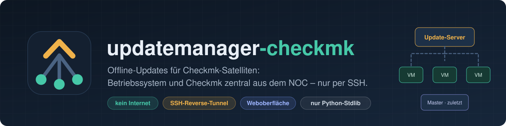
</p>

<p align="center">
  
  
  
  
  
</p>

<p align="center">
  <a href="#warum">Warum?</a> ·
  <a href="#funktionen">Funktionen</a> ·
  <a href="#so-funktionierts">So funktioniert’s</a> ·
  <a href="#weboberfläche">Weboberfläche</a> ·
  <a href="#schnellstart">Schnellstart</a> ·
  <a href="docs/HILFE.md">Handbuch</a>
</p>

---

**updatemanager-checkmk** hält verteilte Checkmk-Installationen aktuell – auch dann, wenn die Remote Sites
beim Kunden **keinen Internetzugang** haben. Ein Update-Server im NOC spiegelt die Paketquellen, lädt neue
Checkmk-Releases und spielt Betriebssystem- und Checkmk-Updates im Wartungsfenster per SSH ein:
**alle Remote Sites gleichzeitig, der Master zuletzt.** Auf den Zielsystemen wird nichts installiert.

> *English:* A self-hosted update orchestrator for distributed Checkmk setups with offline satellites.
> It mirrors OS repositories and Checkmk releases on a central server and updates OS + Checkmk on all
> remote sites over SSH with a reverse tunnel – remote sites first, central site last. The UI and docs are in German.

## Warum?

Checkmk-Satelliten beim Kunden stehen oft in abgeschotteten Netzen: kein Internet, keine Freigabe nach außen,
nur ein SSH-Zugang aus dem NOC. Updates heißen dann meistens *„einloggen, Pakete per Hand kopieren, hoffen“* –
und zwar bei jedem Kunden und für jedes Patch-Release.

updatemanager-checkmk macht daraus einen automatischen, nachvollziehbaren Ablauf:

| Ohne | Mit updatemanager-checkmk |
|---|---|
| Pakete per Hand auf jede VM kopieren | eigenes Offline-Repo je Betriebssystem, erreichbar über den SSH-Tunnel |
| Reihenfolge Remote Sites → Master im Kopf behalten | fest eingebaut, Master nur wenn alle Remote Sites erfolgreich waren |
| Backup vergessen, Rollback improvisieren | Backup vor jedem Checkmk-Update, automatischer Rollback bei Fehler |
| Downtimes von Hand setzen | Downtimes über die REST-API, nach dem Update wieder entfernt |
| „Welcher Kunde hat welche Version?“ | Übersicht mit Versionen, offenen Updates und Zielversion |
| alte Checkmk-Versionen sammeln sich an | automatisches Aufräumen im Repo und auf den Systemen |

## Funktionen

- 🔌 **Offline-fähig** – Die Satelliten brauchen kein Internet und keine Freigabe nach außen. Während eines Laufs
  öffnet der Update-Server einen SSH-Reverse-Tunnel; das Repo ist auf dem Satelliten dann unter `127.0.0.1:3142` erreichbar.
- 🧭 **Erkennt alles selbst** – Betriebssystem, Version, Kernel, offene Updates, Checkmk-Version und Edition werden
  per SSH ermittelt. Kein Agent, keine Skripte, keine Zugangsdaten auf den Zielsystemen.
- 📦 **Eigenes Repository je OS** – Ubuntu, Debian, RHEL/Rocky/Alma/Oracle/CentOS Stream, SLES/openSUSE.
  Datierte Snapshots als Rückfallebene, GPG-signiert, ausgeliefert per nginx.
- 🚀 **Checkmk-Patch- und Major-Updates** – Neue Releases werden täglich erkannt, per SHA256 geprüft und ins Repo geladen.
  Major-Schritte nur mit Regelprüfung (eine Version pro Schritt, vorher neuester Patch, Paket für jedes OS vorhanden, passende Edition).
- ⚡ **Parallel** – Alle Kunden werden gleichzeitig aktualisiert (einstellbar), der Master als Letztes.
- 🛟 **Sicher** – Vorprüfung (SSH, sudo, Tunnel, Uhrzeit, Site), `omd update` ohne `-f`, Backup und automatischer Rollback.
- 🗓️ **Zeitplan** – Repo-Sync täglich, Wartungsfenster frei wählbar. Änderungen gelten sofort, ohne sudo.
- 🖥️ **Weboberfläche** – optional, zum Ein- und Ausschalten: Übersicht, Repository, Läufe live, Zeitplan, Einstellungen, Hilfe.
- 🔔 **Benachrichtigungen** – Microsoft-Teams-Karte nach jedem Lauf (mit Paketliste) und Status als Checkmk-Services.
- 🧹 **Aufräumen** – nicht mehr benötigte Checkmk-Pakete im Repo und auf den Systemen (`omd cleanup`) werden entfernt.
- 🧪 **Labormodus** – setzt Testsysteme auf ältere Checkmk- und OS-Stände zurück, um den kompletten Ablauf zu üben.
- 🐍 **Ohne Abhängigkeiten** – Python 3, nur Standardbibliothek. Menü mit Einrichtungsassistent, alles auch als CLI-Befehl.

## So funktioniert’s

<p align="center">
  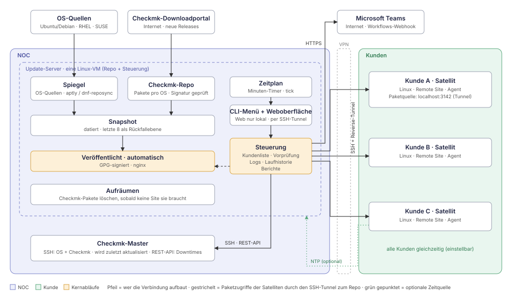
</p>

Der **Update-Server** (eine Linux-VM im NOC) vereint Repository und Steuerung. Er baut jede Verbindung selbst auf –
die Kunden-VMs verbinden sich nie ins NOC. Pakete laufen ausschließlich durch den Tunnel in dieser SSH-Verbindung.
Ohne Lauf kein Tunnel, ohne Tunnel keine Pakete: Updates kommen nur aus dem gesteuerten Ablauf.

### Ein Wartungsfenster

<p align="center">
  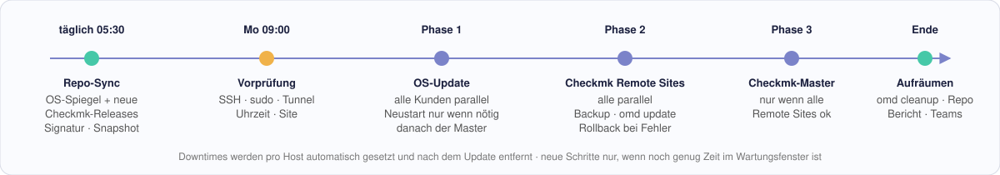
</p>

<details>
<summary><b>Detaillierter Ablauf (OS-Update und Checkmk-Update)</b></summary>
<br>
<p align="center">
  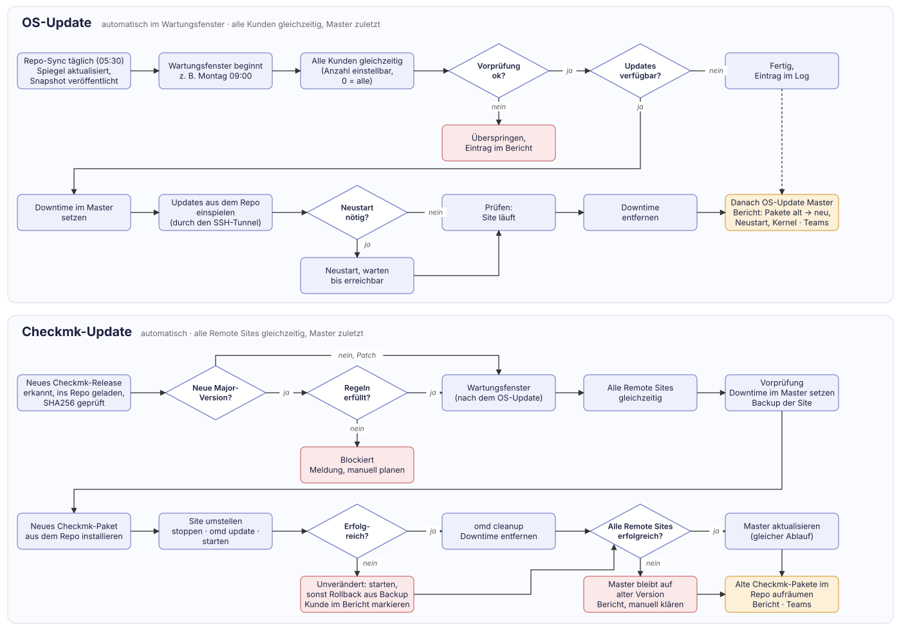
</p>
</details>

### Entscheidungen pro Site

| Situation | Aktion |
|---|---|
| Site auf Zielversion | nichts |
| Site älter, gleiche Major-Version | Remote Site aktualisieren |
| alle Remote Sites erfolgreich, Master älter | Master aktualisieren |
| mindestens eine Remote Site nicht erfolgreich | Master bleibt, Bericht |
| neue Major-Version, alle Regeln erfüllt | Major-Schritt: erst Remote Sites, dann Master |
| neue Major-Version, Regel verletzt | blockiert, Meldung (z. B. „OS-Upgrade nötig“) |
| Edition weicht ab | blockiert, Meldung |
| Vorprüfung fehlgeschlagen | überspringen, Bericht |

## Weboberfläche

Die Weboberfläche ist optional (`updatemanager-checkmk web on`), läuft standardmäßig nur auf `127.0.0.1:8470`
und wird per SSH-Tunnel geöffnet. Sie kann alles, was das Terminal-Menü kann – mit Live-Ausgabe der Läufe.
Hell und dunkel, mit eigenen Benutzern.

<p align="center">
  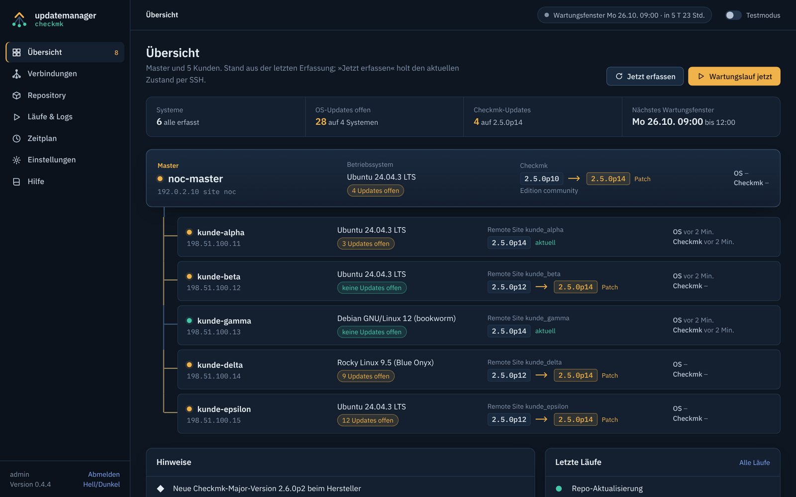
</p>

<table>
  <tr>
    <td width="50%">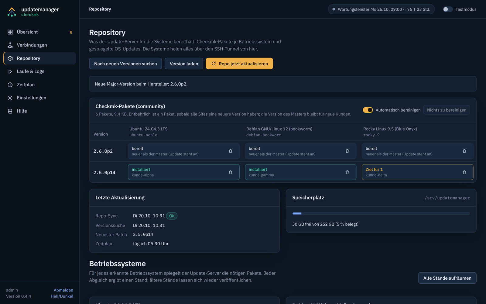<br><sub><b>Repository</b> – Checkmk-Pakete je Betriebssystem, automatische Bereinigung</sub></td>
    <td width="50%">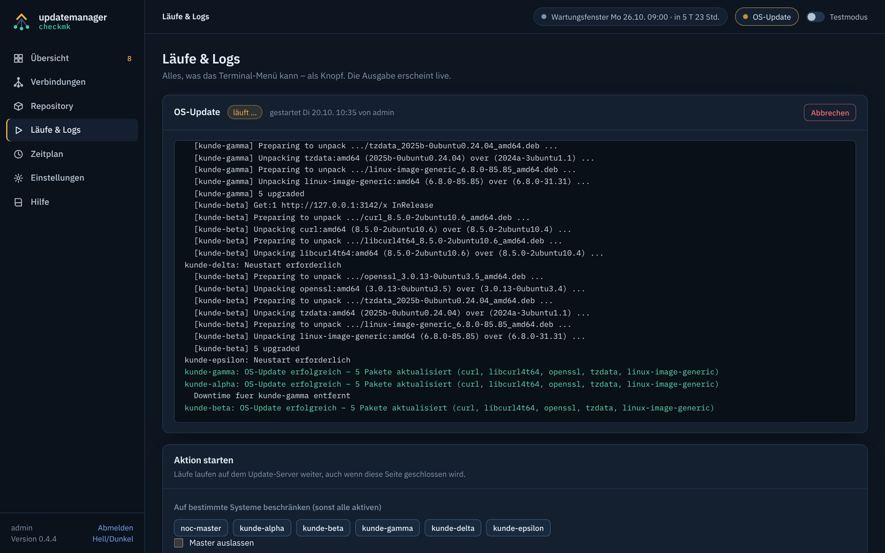<br><sub><b>Läufe live</b> – Ausgabe in Echtzeit, Abbrechen jederzeit möglich</sub></td>
  </tr>
  <tr>
    <td width="50%">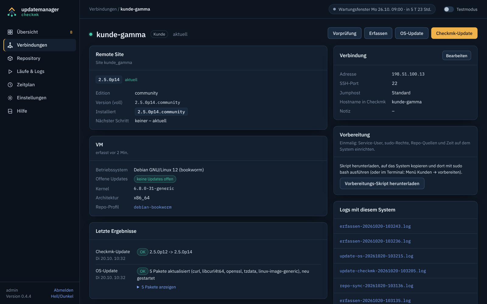<br><sub><b>System</b> – Verbindung, Remote Site, VM und letzte Ergebnisse</sub></td>
    <td width="50%">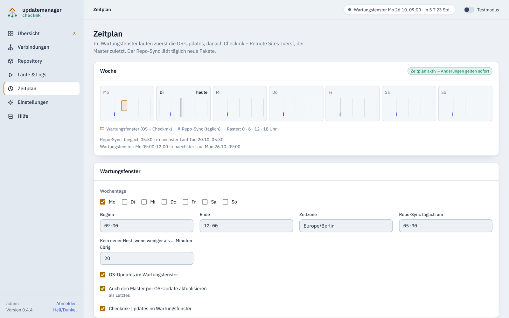<br><sub><b>Zeitplan</b> – Wartungsfenster und Repo-Sync, gilt sofort</sub></td>
  </tr>
</table>

<details>
<summary><b>Hell-Modus und Anmeldung</b></summary>
<br>
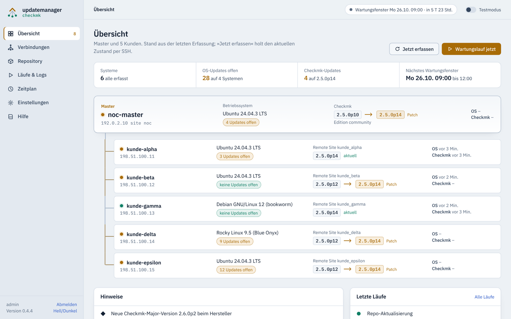
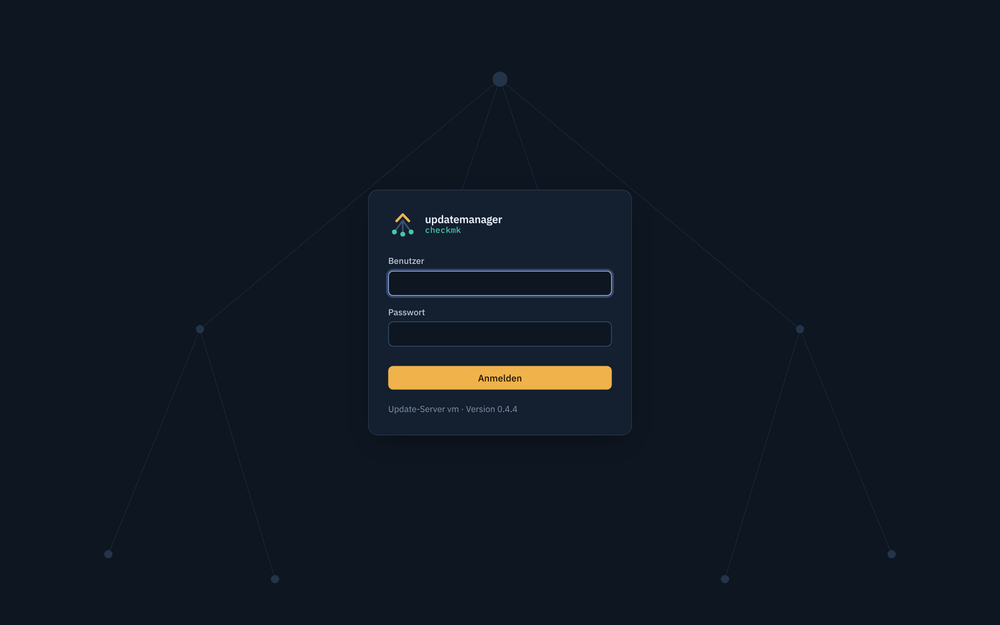
</details>

> Die Screenshots stammen aus einer Testumgebung mit erfundenen Systemen und Adressen aus den Dokumentationsnetzen.

## Schnellstart

**Voraussetzungen**

- Update-Server: Ubuntu Server (getestet mit 24.04), Python 3, Internetzugang für Paketquellen und Checkmk-Download
- Master und Satelliten: ein von Checkmk unterstütztes Linux, erreichbar per SSH vom Update-Server
- Checkmk 2.x – Community oder kommerzielle Edition (für kommerzielle Editionen: Download-Zugang zum Kundenportal)
- Ein Automationsbenutzer auf dem Master (REST-API, Recht auf Downtimes)

**Vorher bereitlegen:** IP und Site-Name des Masters, einen Automation-User mit Secret im Master,
je Kunden-VM die IP, den Namen der Remote Site und einen Admin-Login mit sudo.

**Installation und Einrichtung – in einem Durchgang**

```bash
git clone https://github.com/Wolkenschmiede/updatemanager-checkmk.git
cd updatemanager-checkmk
./install.sh                     # installiert nach /opt/updatemanager-checkmk
updatemanager-checkmk            # Einrichtungsassistent
```

Der Assistent fragt die Einstellungen ab und erledigt danach alles, damit die Updates sofort automatisch laufen:

1. Update-Server einrichten (aptly, nginx, Repo-Schlüssel, optional Zeitquelle)
2. REST-API des Masters prüfen
3. Master und Kunden vorbereiten – per Admin-Login der jeweiligen VM
4. Repo synchronisieren
5. Verbindung zu allen Systemen testen
6. Zeitplan aktivieren – optional Weboberfläche und Teams

Jeder Schritt lässt sich überspringen. Was offen ist, zeigt die **Checkliste** im Menü (`e`), in der Weboberfläche
und per `updatemanager-checkmk checklist`.

**Später erweitern**

| Aufgabe | Menü |
|---|---|
| Neuen Kunden anbinden (anlegen, vorbereiten, testen) | `2 → n` |
| Master ändern | `3 → 1` |
| Was fehlt noch? | `e` |

Alle Befehle: `updatemanager-checkmk -h` · Handbuch: `updatemanager-checkmk --help` bzw. [docs/HILFE.md](docs/HILFE.md).

## Sicherheit

- Der Update-Server darf auf allen Satelliten Pakete installieren – er ist damit ein **hochprivilegiertes System**
  und gehört entsprechend geschützt.
- Der Service-Benutzer auf den Zielsystemen meldet sich nur per Schlüssel an und hat sudo ausschließlich für
  Paketverwaltung, `omd` und `reboot`.
- Geheimnisse (Download-Zugang, REST-API-Secret, Teams-Webhook) liegen nur im Secrets-Verzeichnis des
  Update-Servers (Rechte 600) – nie in `conf/` und nie im Git.
- Die Weboberfläche lauscht standardmäßig nur lokal, nutzt gehashte Passwörter (PBKDF2), HttpOnly-/SameSite-Cookies,
  CSRF-Schutz und eine strikte Content-Security-Policy. HTTPS ist optional (`web tls`).

Sicherheitslücke gefunden? Siehe [SECURITY.md](SECURITY.md).

## Stand und Grenzen

- Im Labor durchgespielt: Ubuntu 24.04, Checkmk 2.5 Community – Repo-Sync, OS- und Patch-Updates im Zeitplan, Labormodus, Teams.
- Debian, die EL-Familie und SUSE sind eingebaut, aber noch nicht an echten Systemen geprüft.
- OS-Release-Upgrades (z. B. Ubuntu 22.04 → 24.04) bleiben manuell; das Programm meldet, wenn sie nötig werden.
- Download-Pfade für kommerzielle Editionen sind noch nicht mit echten Zugangsdaten geprüft.
- E-Mail-Benachrichtigung ist nicht eingebaut (Teams und Checkmk-Services schon).

Rückmeldungen aus anderen Umgebungen sind sehr willkommen – gern als Issue.

## Dokumentation

| Dokument | Inhalt |
|---|---|
| [docs/HILFE.md](docs/HILFE.md) | Handbuch: Einrichtung, Master und Kunden vorbereiten, Befehle, Weboberfläche, Fehlerbehebung |
| [docs/PROGRAMMBESCHREIBUNG.md](docs/PROGRAMMBESCHREIBUNG.md) | Konzept: Grundprinzipien, Architektur, Abläufe, Rechte |
| [tools/](tools/) | Skripte zum Entfernen und vollständigen Zurücksetzen (siehe Handbuch) |
| [CHANGELOG.md](CHANGELOG.md) | Änderungen je Version |

## Lizenz und Hinweise

Veröffentlicht unter der [MIT-Lizenz](LICENSE). Die mitgelieferten Schriften IBM Plex stehen unter der
[SIL Open Font License](umc/web/fonts/OFL.txt).

Dies ist ein unabhängiges Community-Projekt und steht in keiner Verbindung zur Checkmk GmbH.
„Checkmk“ ist eine Marke der Checkmk GmbH. Updates verändern produktive Systeme – bitte zuerst in einer
Testumgebung ausprobieren (dafür gibt es den Labormodus).
